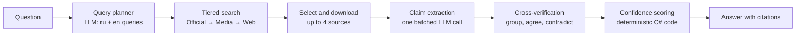

<div align="center">

# 🦉 NightOwl

**An AI research assistant that finds the most reliable and up-to-date information on the web, ranks sources by trust level, cross-checks them against each other, and tells you how confident it is, with citations.**


</div>

---

## Why NightOwl?

Ordinary chatbots give fluent answers without telling you *where* a fact came from or *how much* to trust it.
NightOwl is built around the opposite idea:

- 🏛️ **Official sources first**: government, international organizations and primary documents outrank everything else.
- 📰 **Then media**: reputable news outlets come next, then reference works, then everything else.
- ⚖️ **Cross-verification**: every fact is compared across independent sources; agreement raises confidence, contradictions lower it.
- 🔢 **Transparent confidence score**: a percentage computed by deterministic code (not guessed by an LLM), with every claim linked to its sources.
- 🌍 **Russian and English** sources are searched and compared together.

> ⚠️ The confidence percentage is a heuristic based on source level, agreement, freshness and diversity. It is **not** a guarantee of truth. Always verify critical information yourself.

## Features

### Research pipeline
- **Query planning**: an LLM turns your question into search queries in two languages and decides whether freshness matters.
- **Tiered search**: separate searches restricted to official domains, to media domains, and to the whole web, so primary sources never drown in noise.
- **Source classification**: every URL is assigned one of four trust tiers using an editable `sources.json`.
- **Balanced source selection**: at most one source per root domain, a mix of tiers (2 official + 2 media preferred), with spare candidates in case a page cannot be downloaded.
- **Content extraction**: article text is extracted with a readability algorithm, with encoding handling for legacy Russian sites and a snippet fallback for blocked pages.
- **Batched claim extraction**: facts are pulled from all sources in a *single* LLM call and normalized to the language of the question.
- **Claim grouping**: equivalent claims from different sources are grouped; contradictions are detected.
- **Confidence scoring**: deterministic, unit-tested formula (see below).
- **Cited answer**: the final answer contains `[1][2]` references to numbered sources.

### Reliability and cost control
- **Graceful degradation**: if an LLM step fails, NightOwl still answers and reports what went wrong in `warnings` (no cross-check → individual scoring; no synthesis → fact list).
- **Model fallback chain**: when the primary model returns `429`/`503`, the next configured model is tried.
- **Smart throttling**: minimum interval between LLM calls, `Retry-After` support, and no pointless retries on *daily* quota errors.
- **SQLite cache**: answers, search results and downloaded pages are cached with sensible TTLs. Repeated questions cost zero API calls. Degraded answers are never cached.
- **Rate limiting** on the API (5 questions per minute per IP) to protect quotas and budget.

### Interfaces
- **Web app** (React + TypeScript) with live progress, color-coded confidence, clickable citations and source tier badges.
- **REST + Server-Sent Events API** for building your own clients.
- **CLI** with rich terminal output.

## How it works



### Source tiers

| Tier | Type | Examples | Base weight |
|------|------|----------|-------------|
| 1 | **Official** | `.gov`, WHO, UN, central banks, regulators | 1.00 |
| 2 | **Media** | Reuters, BBC, AP, major national outlets | 0.75 |
| 3 | **Reference** | Wikipedia, scientific publishers | 0.55 |
| 4 | **Unofficial** | blogs, forums, social networks | 0.25 |

The lists live in [`src/NightOwl.Credibility/sources.json`](src/NightOwl.Credibility/sources.json). Unknown domains default to *Unofficial*.

### Confidence formula

```
Confidence = BaseWeight   × 0.35
           + Agreement    × 0.35
           + Freshness    × 0.20
           + Diversity    × 0.10
           − Penalty
```

| Component | Meaning |
|-----------|---------|
| **BaseWeight** | Weight of the best supporting source |
| **Agreement** | Sum of weights of *independent root domains* supporting the claim, divided by 2 (capped at 1) |
| **Freshness** | `0.5^(age / half-life)` of the newest supporting source; half-life is 30 days if the question is time-sensitive, otherwise 3 years |
| **Diversity** | Number of distinct tiers among supporters: 1 → 0.3, 2 → 0.7, 3+ → 1.0 |
| **Penalty** | `0.5 × contradicting weight / (supporting + contradicting weight)` |

LLMs understand text (extract facts, match meaning); **the number itself is computed by code**, so it is reproducible and testable.

## Tech stack

| Area | Technology |
|------|------------|
| Backend | C#, .NET 10, ASP.NET Core Minimal API |
| LLM | Gemini via its OpenAI-compatible endpoint, `Microsoft.Extensions.AI` |
| Search | [Tavily](https://tavily.com) Search API |
| Extraction | SmartReader (Readability port), `HttpClient` with Polly resilience |
| Cache | SQLite (`Microsoft.Data.Sqlite`) |
| Frontend | React, TypeScript, Vite |
| CLI | Spectre.Console |
| Tests | xUnit, NSubstitute, Shouldly |

## Project structure

```
NightOwl/
├─ src/
│  ├─ NightOwl.Core/          # models and interfaces (no dependencies)
│  ├─ NightOwl.Search/        # search providers (Tavily)
│  ├─ NightOwl.Extraction/    # page download and text extraction
│  ├─ NightOwl.Credibility/   # source tiers, source selection, confidence scoring
│  ├─ NightOwl.AI/            # LLM layer: planner, claims, grouping, synthesis, throttling, fallback
│  ├─ NightOwl.Pipeline/      # orchestration, caching, DI composition root
│  ├─ NightOwl.Api/           # REST + SSE API
│  └─ NightOwl.Cli/           # console app
├─ web/                       # React + TypeScript frontend
└─ tests/NightOwl.Tests/      # unit tests
```

## Getting started

### Prerequisites
- [.NET 10 SDK](https://dotnet.microsoft.com/download)
- [Node.js](https://nodejs.org) 20.19+ or 22.12+ (for the frontend)
- A [Tavily](https://tavily.com) API key
- A [Gemini](https://aistudio.google.com) API key

### 1. Clone and configure

```bash
git clone https://github.com/Nika-nerd/NightOwl.git
cd NightOwl

# Secrets are stored outside the repository (shared by the API and CLI)
dotnet user-secrets set "Tavily:ApiKey" "YOUR_TAVILY_KEY" --project src/NightOwl.Api
dotnet user-secrets set "Gemini:ApiKey" "YOUR_GEMINI_KEY" --project src/NightOwl.Api
dotnet user-secrets set "Gemini:Model"  "YOUR_MODEL_NAME" --project src/NightOwl.Api

# Optional: fallback models tried on 429/503
dotnet user-secrets set "Gemini:FallbackModels:0" "ANOTHER_MODEL_NAME" --project src/NightOwl.Api
```

> Free-tier Gemini quotas are small (for example, 20 requests per day per model at the time of writing). Each uncached question uses about 4 LLM calls, so configure a fallback model or enable billing for heavier use.

### 2. Run the API and the web app

```bash
# Terminal 1: API
dotnet run --project src/NightOwl.Api --urls http://localhost:5080

# Terminal 2: frontend
cd web
npm install
npm run dev
```

Open **http://localhost:5173**. The Vite dev server proxies `/api` to the API.

### 3. Or use the CLI

```bash
dotnet run --project src/NightOwl.Cli -- "How many measles cases were there in Europe in 2025?"
```

### Run the tests

```bash
dotnet test
```

## API reference

| Method | Endpoint | Description |
|--------|----------|-------------|
| `GET` | `/health` | Liveness check |
| `POST` | `/api/ask` | Ask a question, get the full answer as JSON |
| `GET` | `/api/ask/stream?q=...` | Ask a question and receive progress as Server-Sent Events |

Questions must be 3-500 characters. `/api/ask*` is limited to 5 requests per minute per IP.

### Streaming events

| Event | Payload |
|-------|---------|
| `progress` | `{ "stage": "Searching", "message": "..." }` |
| `result` | the full answer (see below) |
| `failure` | `{ "message": "..." }` |

Stages: `Planning`, `Searching`, `Filtering`, `Downloading`, `ExtractingClaims`, `Verifying`, `Answering`.

```bash
curl -N -G "http://localhost:5080/api/ask/stream" \
  --data-urlencode "q=How many measles cases were there in Europe in 2025?"
```

### Answer shape

```json
{
  "question": "…",
  "summary": "Text with citations [1][2].",
  "overallConfidencePercent": 87,
  "claims": [
    { "text": "…", "confidencePercent": 91, "supporting": [1, 2], "contradicting": [] }
  ],
  "sources": [
    {
      "number": 1,
      "title": "…",
      "url": "https://www.who.int/…",
      "domain": "who.int",
      "tier": "Official",
      "publishedAt": "2026-02-11T00:00:00+00:00"
    }
  ],
  "language": "en",
  "needsFreshness": false,
  "queries": ["…", "…"],
  "warnings": [],
  "fromCache": false
}
```

## Configuration

Settings can be provided through user-secrets, `appsettings.json` or environment variables (use `__` instead of `:`, for example `Tavily__ApiKey`).

| Key | Default | Description |
|-----|---------|-------------|
| `Tavily:ApiKey` | *required* | Tavily API key |
| `Gemini:ApiKey` | *required* | Gemini API key |
| `Gemini:Model` | *required* | Primary model name |
| `Gemini:FallbackModels:N` | none | Models tried when the primary returns 429/503 |
| `Gemini:MinSecondsBetweenCalls` | `3` | Minimum delay between LLM call starts |
| `NightOwl:MaxSources` | `4` | Sources used per answer |
| `NightOwl:CandidateReserve` | `2` | Extra candidates in case downloads fail |
| `NightOwl:QueriesPerQuestion` | `2` | Planned queries actually searched |
| `NightOwl:MaxDownloadConcurrency` | `4` | Parallel page downloads |
| `NightOwl:UseRelevanceFilter` | `false` | Extra LLM call that filters irrelevant results |
| `NightOwl:MaxClaimsToVerify` | `40` | Cap on claims sent to grouping |
| `NightOwl:TopClaimsInAnswer` | `8` | Claims used for the final answer |
| `NightOwl:Cache:Enabled` | `true` | Enable the SQLite cache |
| `NightOwl:Cache:Path` | platform default | Cache database file |
| `NightOwl:Cache:AnswerTtl` | `24:00:00` | Answer lifetime (`AnswerTtlFresh` = 1 h for time-sensitive questions) |
| `NightOwl:Cache:SearchTtl` | `06:00:00` | Search results lifetime (`NewsSearchTtl` = 30 min) |
| `NightOwl:Cache:PageTtl` | `24:00:00` | Downloaded page lifetime |
| `Cors:Origins` | `["http://localhost:5173"]` | Allowed browser origins |

## Known limitations

- Free-tier API quotas are tight; the cache and model fallback exist for this reason.
- The confidence score is heuristic and depends on the curated source lists.
- JavaScript-only pages, paywalls and PDFs fall back to search snippets.
- Query planning and extraction quality depend on the LLM used.
- Your questions are sent to the search provider and the LLM provider.

## Roadmap

### ✅ v0.1: Backend and basic UI
- [x] Tiered search (official → media → web)
- [x] Source classification and balanced source selection
- [x] Content extraction with encoding and snippet fallback
- [x] Batched claim extraction, grouping and contradiction detection
- [x] Deterministic confidence scoring with unit tests
- [x] Cited answers
- [x] LLM throttling, model fallback and graceful degradation
- [x] SQLite cache
- [x] REST + SSE API with rate limiting
- [x] React + TypeScript frontend, CLI

### 🐳 v0.2: Docker and CI
- [ ] Multi-stage `Dockerfile` for the API (published `sources.json`, non-root user)
- [ ] Frontend image (Vite build served by nginx, `/api` reverse proxy)
- [ ] `docker-compose.yml` for the full stack with health checks and a persistent cache volume
- [ ] Configuration via environment variables and `.env.example`
- [ ] GitHub Actions: build, test and lint on every push and pull request
- [ ] Publish images to GitHub Container Registry

### 🔎 v0.3: Search-engine-style frontend
- [ ] Results page that looks like a search engine: ranked source cards with titles, snippets, domains and tier badges
- [ ] Filters and sorting by tier, date and confidence; "show all sources found", not only the ones used
- [ ] Search history and saved answers (local storage first)
- [ ] Shareable links for answers (`/q/…`)
- [ ] Query suggestions and example questions
- [ ] `fetch`-based streaming with precise error messages (rate limit, validation, server error) and a retry button
- [ ] Light/dark theme, mobile polish, accessibility pass
- [ ] Frontend tests (Vitest and Testing Library)

### 📚 v0.4: Source quality
- [ ] More search providers (SearXNG, news RSS, Wikipedia API) behind the existing provider interface
- [ ] Better publication-date detection (metadata, JSON-LD) and per-claim dates
- [ ] PDF support for official reports
- [ ] Language detection and more languages
- [ ] Evaluation set to calibrate and test the scoring formula
- [ ] Community-maintained, versioned source lists

### 🚀 v0.5: Production hardening
- [ ] Structured logging (Serilog) and OpenTelemetry tracing
- [ ] API keys and per-user quotas
- [ ] Persistent history in a database; optional Redis cache
- [ ] Optional self-hosted LLMs (Ollama) as a provider

## Contributing

The project is in early development. Issues and ideas are welcome. Please run `dotnet test` and `npm run build` in `web/` before opening a pull request.

## License

To be decided.
````
